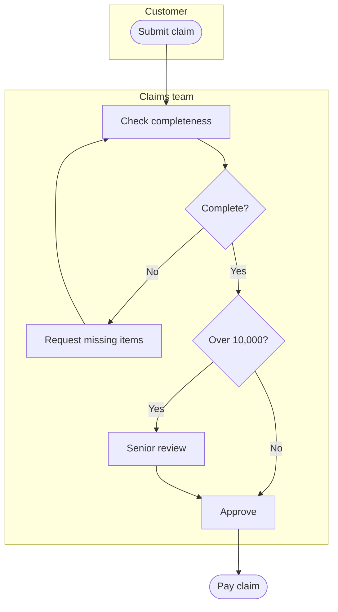

# Process mapping

A map is a shared picture. If two people look at it and disagree, the map has done its job.

## Steps

1. **Fix the boundaries**: a trigger (start) and an end result.
2. **List the steps** as verb + object ("Check credit", "Send approval"). One person per step (the swimlane).
3. **Add decisions** as questions with labelled exits ("Over 10,000? Yes / No").
4. **Mark handoffs** between lanes. Delays and errors cluster there.
5. **Show systems** used at each step, and where data is copied by hand.
6. **Walk it** with those who do the work, step by step.

## Draw it in Mermaid

````

````

Keep to one page, about 15 steps. Break larger ones into sub-processes.

## Find the waste

Label each step as *adds value*, *needed but adds none* (approval, check) or *waste* (waiting, rework, re-keying, searching). Count handoffs, loops and approvals. Mark the longest wait.

## Output

The diagram, a table of steps with role, system, time and volume, and a short list of improvement ideas with the step each addresses.

## Watch for

- Mapping the procedure manual instead of the real thing (`current-state-analysis`).
- Hiding exceptions. A loop labelled "rework" is where the cost is.
